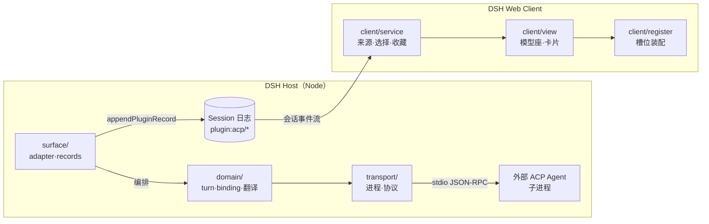

# dsh-acp-pro

把外部 [ACP](https://agentclientprotocol.com) Agent（Codex、Claude Code、Gemini CLI 等）注册成 DeepSeek Harness（dsh）的**模型提供方**，并把外部 Agent 的执行过程写进会话日志，在 dsh Web 端渲染成工具卡 / 计划卡 / 权限卡。

English: a DSH plugin that registers external ACP agents as model providers and renders their tool calls, plans and permission requests in the DSH Web client.

## 功能

**模型提供方**

- 每个 `agents` 配置项 = 一条 provider 路由，出现在 dsh 的模型选择器里；选中后这一轮对话交给该 ACP Agent 处理。
- 模型选择器由本插件接管：左侧是来源图标 rail（`★ 收藏` / `平台` / 每个已启用 ACP 一格），模型行右侧 ☆ 可收藏。`/model` 命令弹窗仍是 dsh 原生那一版。
- 模型列表来自 Agent 的 `configOptions`（`category: "model"`），兼容旧版 `models` + `session/set_model`，也可在配置里手写 `models`。
- 推理等级取自 `thought_level`，按进程代次/工作目录/模型缓存，经标准 `session/set_config_option` 下发；图片输入按握手的 `promptCapabilities.image` 判断，`imageInput` 可覆盖误报。
- 上下文窗口优先级：`models[].contextWindow` → Agent 上报值 → 模型名里的 `1m` 标记 → 路由级 `contextWindow` → `200000`。

**会话桥接**

- 每个 dsh 会话复用同一个 ACP 会话，后续轮次只发送新增的用户消息。
- 绑定、消费游标、用量基线与待确认标记持久化；重启后仅在 Agent 声明 `loadSession` 时尝试加载。请求结果未知时阻止自动重提与历史重放。标题生成、压缩等辅助调用用一次性会话，不记录卡片。

**跨来源切换告知**

- 一个会话同一时刻由一种执行来源承载（dsh 平台 / 某个 ACP 路由）。**来源内换模型或推理等级完全不打扰。**
- 跨来源切换会先问一次：内部会话将重建、历史以文本形式压平传入、对方的工具执行过程不会进入新模型上下文。同一会话同一「来源对」只问一次。
- 没有审批服务、或审批策略为 `never`（如「完全权限」预设）时，切换照常进行并记日志——不会静默失败，也不会把自动拒绝当成用户拒绝。

**执行过程卡片与轨迹**

- **工具卡**：ACP `tool_call` / `tool_call_update` → 紧凑行，显示 kind 图标、标题、文件位置、输入预览、耗时与状态；展开可见全部位置、文本、逐行 diff 与原始 input / output。
- **计划卡**：ACP `plan` → 清单卡，带完成/进行中/取消/待办标记与进度计数。
- **权限卡（展示级）**：显示请求标题、工具 kind、Agent 给出的选项与最终状态；**答复仍走 dsh 原生审批框**，卡片只做记录。
- **轨迹视图**：ACP 工具调用以「外部 ACP 记录」的身份出现在原生轨迹视图里，可看到标题、kind、状态与时间。计划与权限只在 Chat 视图——轨迹没有对应承载形状，硬塞会把计划伪装成工具结果，故不做。
- 卡片由会话日志里的插件记录驱动，刷新、恢复、fork 后重建；记录是 `ignorable` 的仅日志事件，不进入模型可见历史。

**配置入口**

- **设置 → ACP Agents**：添加、编辑、删除 Agent；表单涵盖路由名、显示名、启动命令、参数、环境变量、认证方法、权限策略、图片输入、模型列表、启用开关与来源图标。
- **导入 JSON**：粘贴其他 ACP 客户端（如 Zed 的 `agent_servers`）配置批量导入，先预览再原子写入。**当前会话面板**显示 Agent 确认的配置、模式、命令与恢复状态。

## 架构

插件同时有 Host 端（Node）与 Web Client 端（浏览器），是一个标准 dsh bundle 包（`dsh.bundle.patch` → `cordis.patch.yml`）。



依赖方向单向：Host 是 `surface → domain → transport`，Client 是 `service → view → register`。`domain/` 不读宿主服务、不起进程，可按纯函数单测；Client 的 `service/` 不依赖 React。目标结构与迁移切片见 [ADR-0001](docs/adr/0001-layered-restructure.md)，目标架构图规格见 [docs/design](docs/design/dsh-acp-pro-layered.architecture.json)。

**为什么不用 dsh 原生工具卡**：dsh 的原生工具卡由 dsh 自己的 `tool/call` 事件驱动，而 `tool-call` 这个 Chat node kind 由宿主占用。ACP Agent 的工具不是 dsh 发起的调用，伪造 `tool/call` 会写进模型可见历史并污染后续请求。插件记录是 log-only、`ignorable` 的，不改变模型看到的内容，还能随日志重放。

## 安装

前置：dsh 桌面端（0.2 核心）、Node 22+，以及和桌面端相同的 pnpm（版本见 `~/.dsh/profiles/desktop/node_modules/.modules.yaml` 的 `packageManager`）。

1. `npm install && npm run build`。
2. 在 `~/.dsh/profiles/desktop/package.json` 加依赖与 bundle：`"dependencies": { "dsh-acp-pro": "link:/path/to/dsh-acp-pro" }` 与 `"dsh": { "profile": { "bundles": ["dsh-acp-pro"] } }`。
3. 在该档案目录执行 `npx -y pnpm@<上面的版本> install --prefer-offline --config.minimum-release-age=0`，重启桌面端，然后到 **设置 → ACP Agents** 添加 Agent。

注意：

- **只启用一个 ACP 接入插件**。同一 ACP 路由被两个插件注册会出现重复路由或注册被拒。
- 档案里的插件条目 id 必须是 `dsh-acp-pro`；0.2 核心按条目 id 给设置分段，改了「ACP Agents」页就不出现。
- 设置页改配置不需重启（`agents` 是 volatile 字段）；改档案 YAML 或改代码后需重启。link 模式下插件从自己的 `node_modules` 解析 `@deepseek-ai/*`，与宿主不是同一实例——这是有意设计，插件不依赖 `instanceof`。

## 配置

可直接写档案的 `cordis.patch.yml`（`~/.dsh/profiles/desktop/cordis.patch.yml`）：

```yaml
- id: dsh-acp-pro
  name: dsh-acp-pro
  config:
    agents:
      codex:
        displayName: Codex
        command: /absolute/path/to/npx
        args: [-y, '@agentclientprotocol/codex-acp']
      claude-code:
        displayName: Claude Code
        command: /absolute/path/to/claude-code-acp
    favorites:
      - provider: claude-code
        model: claude-opus-5-5
```

`agents` 是「路由名 → Agent 配置」字典：

| 字段 | 默认值 | 说明 |
| --- | --- | --- |
| `command` | 必填 | 启动命令。桌面端从 Dock 启动时拿不到 shell 的 `PATH`，建议写绝对路径。 |
| `args` | `[]` | 命令参数。 |
| `env` | `{}` | 追加给子进程的环境变量。 |
| `displayName` | 路由名 | 选择器与设置页显示的名字。 |
| `enabled` | `true` | `false` 时该路由不再注册为提供方：从选择器、`/model` 与官方「模型」页消失，设置页保留以便重开。运行中的回合先跑完再回收子进程。 |
| `icon` | 显示名首字母 | 来源图标。内置名 `claude`/`codex`/`gemini`/`deepseek`/`openai`/`opencode` 用矢量图标；其他值按 emoji 或图片 URL；认不出则回退首字母。 |
| `cwd` | 会话 workspace | 子进程目录，也是取不到会话 workspace 时的 ACP 会话目录。 |
| `authMethod` | 无 | 握手后调用 `authenticate` 的方法 id；报错会列出 Agent 支持的方法。 |
| `models` | `[]` | 手动声明模型（`id`/`name`/`description`/`contextWindow`）；声明后不再自动发现。 |
| `discoverModels` | `true` | 未声明模型时是否启动 Agent 读取其公布的列表。 |
| `permission` | `ask` | `ask` 走原生审批框（无审批服务时降级 `read-only`）；`allow` 全允许；`read-only` 只允许 read/search/think/fetch；`reject` 全拒绝。 |
| `imageInput` | `auto` | `auto` 按握手能力判断；`force` 强制开启；`off` 一律文本占位。 |
| `systemPrompt` | `drop` | `forward` 会把 dsh 系统提示词包进 `<system_instructions>` 转发。dsh 提示词描述的是 dsh 自己的工具，一般不建议转发。 |
| `showToolCalls` | `false` | `true` 时额外把工具与计划压平进推理块（旧行为）。卡片由记录驱动，不受此开关影响。 |
| `forwardMcp` | `true` | 是否把 dsh 已配置的 MCP servers 经 `session/new` 传给该 Agent。设置页暂无此开关，需改 YAML。 |
| `contextWindow` | `200000` | 上报给 dsh 的上下文窗口；Agent 上报过实际大小时以实际值为准。 |
| `startupTimeoutMs` | `60000` | 握手超时。 |
| `idleTimeoutMs` | `600000` | 流式空闲超时，`0` 关闭。计时器在 Agent 每次上报时重置，因此持续产出思考流的回合不会超时；超时以 `TIMEOUT` 结束且优先于取消。 |

`favorites` 是 `agents` 同级的列表，只存 `provider` + `model` 身份、不存可用性；指向已停用路由的收藏会保留但不显示，重开即回来。收藏随 profile 配置走，不依赖浏览器 localStorage（dsh web 端口每次启动会变）。

插件学到的元数据存放在 `$DSH_HOME/cache/dsh-acp-pro/`：`prompt-capabilities.json` 与 `context-windows.json`。

## 限制

**执行模型**

- **外部 Agent 用自己的工具**：dsh 的工具不传给 ACP Agent，插件也不产出 dsh 的 `tool/call`；一轮对话由 Agent 自己跑完。
- **MCP 透传有边界**：dsh 配置的 MCP servers 会经 `session/new` 传给外部 Agent，但支持与否由 Agent 决定；转发后每个 Agent 各自建连，进程与网络开销也由它承担。映射不出的 server 会被跳过并记日志；`forwardMcp: false` 可关闭单个路由。
- **不重试**：`retryPolicy` 固定 0 次，避免 Agent 重复执行有副作用的操作。

**可观测性**

- **权限卡只展示**：没有可点击的允许/拒绝按钮，答复仍走原生审批框。
- **终端输出是占位**：工具卡里的 ACP `terminal` 内容只显示占位文本，不渲染终端流。
- **计划与权限不进轨迹**：轨迹视图只有 ACP 工具行；这两类没有对应的承载形状，不做伪装。
- **文件按文本句柄发送**：dsh 在进入适配器前已把文件块换成句柄文本，因此 ACP 的 `resource` / `embeddedContext` 用不上。

**用量精度**

- **用量是估算**：ACP 只提供会话级累计量，本回合数字是相邻上报快照的差值——不是账单级精确值。
- **上下文窗口可能不准**：`usage_update` 上报的是 Agent 自报的窗口大小而非当前占用量；该值作分母在语义上正确但可能失真。
- **恢复后首回合无基线**：此时不产生用量数字，而不是记为 0。

**跨来源**

- **切换会重建**：跨来源切换会丢弃 ACP 内部会话、把历史压平成文本传入新来源，且对方的工具执行过程不可见。这是设计取舍，通过切换前的告知让用户知情。

**兼容性**

- **只支持 dsh 0.2 核心**：影子替换依赖 0.2 的 slot 引擎与 `modelDirectories` 服务。0.1 核心的客户端半边不加载，会自然退回原生选择器。
- **`/model` 弹窗不分组**：它走 dsh 自己的命令弹窗，仍是原生版。两个入口共用同一份会话选择，但外观不同。
- **第三方模型名徽标在影子选择器里不生效**：原生选择器支持 `model.label` 内联扩展，本插件整座替换了座位且不能重复声明该子插槽；`/model` 里照旧。
- **官方「模型」页不能编辑 ACP 路由**：插件按 DOM 替换把提示指向「ACP Agents」页；YAML 声明的路由在设置页带 `YAML` 标记，可覆盖字段但不能改名或删除。
- **会话「完全权限」预设会影响 ACP 审批**：该预设下 dsh 审批策略为 `never`，ACP 权限请求会被自动拒绝（不是静默放行），外部 Agent 可能提前结束回合。想让它在「完全权限」下也能操作，把该路由 `permission` 设为 `allow`。

**依赖风险**

- **记录依赖非稳定 API**：本插件用 `appendPluginRecord` 写 `plugin:acp/*` 记录。dsh 把该 API 限定给 `packages/experimental/` 内的包，对外部插件不是稳定承诺——升级 dsh 时需复核兼容性。写入被拒时会静默禁用记录，对话不受影响。
- **记录形状需自行兼容**：记录是 `ignorable` 的仅日志事件，旧版 dsh 会跳过并保留；但读取端直接消费当前声明的形状，未来改字段需自行做版本兼容。

## 开发

构建、测试、客户端约束与已知接缝见 [docs/dsh-plugin-dev/README.md](docs/dsh-plugin-dev/README.md)。分层重构计划见 [ADR-0001](docs/adr/0001-layered-restructure.md)。

```bash
npm run build      # tsdown：dist/index.js + dist/client.cjs
npm run typecheck  # tsc --noEmit
npm test           # vitest
```

## 许可证

本仓库以 **MIT** 发布，见 [LICENSE](LICENSE)（Copyright (c) 2026 Oasis）。第三方组件与商标说明见 [NOTICE](NOTICE)。
