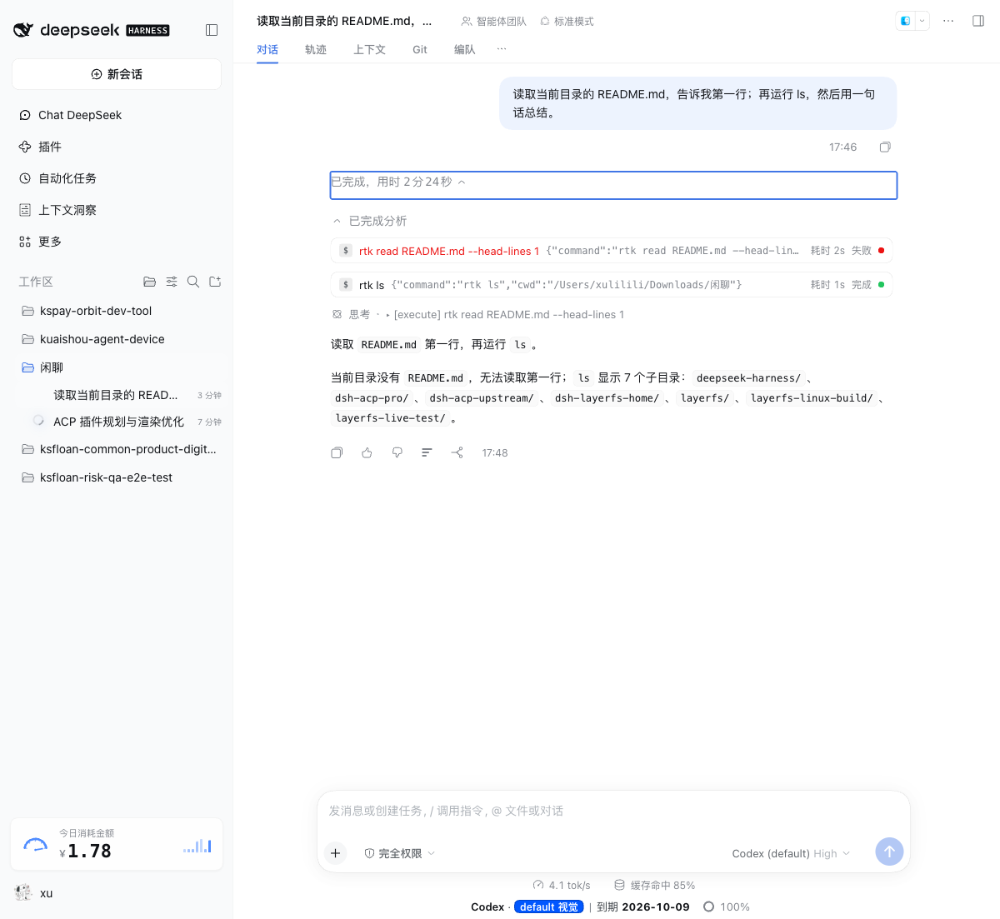
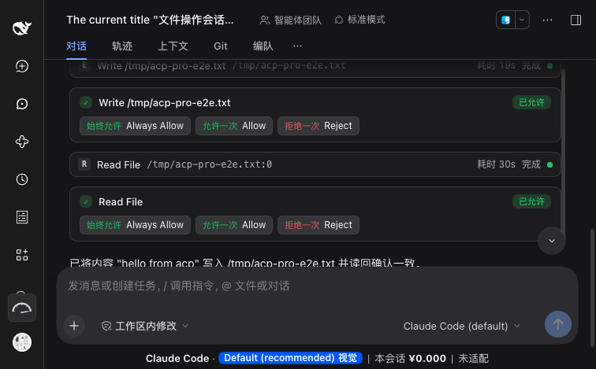
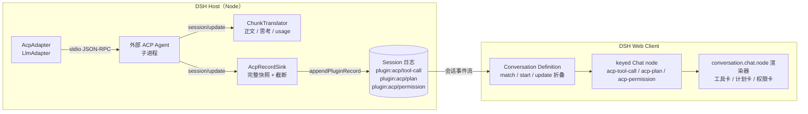

# dsh-acp-pro

把外部 [ACP](https://agentclientprotocol.com) Agent（Codex、Claude Code、Gemini CLI 等）注册成 DeepSeek Harness（dsh）的**模型提供方**；并把外部 Agent 的执行过程写进会话日志，在 DSH Web 端渲染成**工具卡 / 计划卡 / 权限卡**。

English: a DeepSeek Harness plugin that registers external ACP agents as model providers and renders their tool calls, plans and permission requests as cards in the DSH Web client.

## 目录

- [这是什么](#这是什么)
- [功能](#功能)
- [截图](#截图)
- [架构](#架构)
- [安装](#安装)
- [构建](#构建)
- [配置](#配置)
- [限制](#限制)
- [开发](#开发)
- [许可证](#许可证)

## 这是什么

dsh 的模型提供方通常是一个 HTTP 接口。本插件把「一个外部 ACP Agent 子进程」包装成一条模型路由（provider）：

- 每个 `agents` 配置项 = 一条 provider 路由，出现在 dsh 的模型选择器里；选中后，这一轮对话交给该 ACP Agent 处理。
- 插件通过 stdio JSON-RPC（ACP v1）拉起 Agent、维持进程常驻，并负责模型列表、推理等级、图片输入能力、上下文窗口这些元数据。
- 外部 Agent 的 `tool_call` / `plan` / 权限请求不只是文本：插件把它们记录进 dsh 会话日志，Web Client 再按记录渲染成卡片。刷新、恢复、fork 会话后卡片可以重建。

插件同时有 Host 端（加载为 dsh 插件）和 Web Client 端（注册设置页与卡片渲染器），是一个标准的 dsh bundle 包（`dsh.bundle.patch` → `cordis.patch.yml`）。

## 功能

### 模型提供方

- **按路由接入**：每个 ACP Agent 一条 provider 路由；模型选择器按 `displayName` 显示。
- **来源分组的选择器**：composer 的模型菜单由本插件接管，左侧是一列图标 rail——`★ 收藏`、`平台`（dsh 自己的 provider），之后每条已启用的 ACP 一个图标。点开先选「模型 / 推理」，模型行右侧的 ☆ 可收藏常用模型。`/model` 命令弹窗仍是 dsh 原生的那一版（不分组）。
- **模型发现**：模型列表来自 Agent 的 `configOptions`（`category: "model"`），兼容旧版 `models` + `session/set_model`；`default` 表示用 Agent 自己的默认模型。也可以在配置里手写 `models` 覆盖。
- **推理等级**：在独立会话中确认目标模型的 `thought_level` 选项和默认值，按进程代次、工作目录和模型缓存；原生选择器的选择经 `session/set_config_option` 下发，不通过切换活动会话来探测元数据。
- **图片输入**：按 ACP 握手应答里的 `promptCapabilities.image` 判断 Agent 能收什么；未握手过时会先做一次「只握手、不开会话」的探测，答案按路由缓存。`imageInput` 可覆盖误报。图片按 dsh 的请求尺寸重新编码后作为 ACP `image` 块发送。
- **上下文窗口**：优先级为 `models[].contextWindow` → Agent 通过 `usage_update` 上报过的大小（缓存复用）→ 模型 id/名称/描述里的 `1m` 标记 → 路由级 `contextWindow` → `200000` 兜底。

### 会话桥接

- 每个 dsh 会话复用同一个 ACP 会话，后续轮次只发送新增的用户消息。
- Agent 支持模型选择时，在原会话切换模型。已确认历史不再匹配且可以安全重建时，新会话会把历史压平成 `<conversation_history>`；这不等于恢复 Agent 内部状态。
- 绑定、消费游标、用量基线和发送前的待确认标记持久化保存。重启后仅在 Agent 声明 `loadSession` 时尝试加载；没有加载能力时明确作为新会话处理。
- 请求结果未知时阻止自动重提和历史重放。会话面板可明确选择新上下文，之后需发送新消息；没有控制面板的宿主可新建 DSH 会话。停止和卸载会取消该活动回合的待决审批。
- 标题生成、压缩等辅助调用使用一次性 ACP 会话，不记录卡片。
- 工作目录取当前 dsh 会话的 workspace，取不到时回退到 `cwd` 配置或用户主目录。

### 执行过程卡片

- **工具卡**：ACP `tool_call` / `tool_call_update` → 紧凑行，显示 kind 图标、标题、文件位置、输入预览、耗时和状态。展开后显示全部文件位置、文本、逐行 diff、终端及链接/图片占位、原始 input / output；文件按钮支持宿主跳转，截断有明确提示，失败和等待状态保持可见。
- **计划卡**：ACP `plan` → 清单卡，带 `✓` 完成 / `●` 进行中 / `×` 取消 / `○` 待办标记与「完成数/总数」。
- **权限卡（展示级）**：ACP 权限请求 → 显示请求标题、工具 kind、Agent 给出的选项（允许一次 / 始终允许 / 拒绝一次 / 始终拒绝）与最终状态（等待答复 / 已允许 / 已拒绝 / 已取消）。**可点击的允许/拒绝按钮尚未提供**；答复仍走 dsh 原生审批框，卡片只做记录与展示。
- **历史重建**：卡片由会话日志里的插件记录驱动，刷新页面、重新打开或恢复会话时按记录重建；记录是 `ignorable` 的仅日志事件，旧版本 dsh 读到会跳过并保留，且不进入模型可见的对话历史。

### 配置入口

- **设置 → ACP Agents**（排在官方「模型」页之后）：添加、编辑、删除 Agent；表单涵盖路由名、显示名、启动命令、参数、环境变量、认证方法、权限策略、图片输入、模型列表。
- **导入 JSON**：粘贴其他 ACP 客户端（如 Zed 的 `agent_servers`）的配置批量导入；先预览「新增/覆盖/跳过」，勾选后原子写入。
- **发现模型**：按已保存的命令启动 Agent，读取它公布的模型并追加到列表。
- 直接改档案 `cordis.patch.yml` 同样生效；设置页的写入也落在这一段配置上。
- **当前会话面板**：在支持 Typert 控制接口的宿主中，显示 Agent 确认的配置、模式、命令和恢复状态；支持普通/分组 select，运行中提交的配置按会话顺序等待应用。模型和思考强度保持原生控件为唯一编辑入口，命令按钮只插入输入框，不自动发送。当前不宣告 boolean 配置能力。

绑定数据优先存放在实际 profile 的 `data/dsh-acp-pro`，无 profile 路径服务时使用 `$DSH_HOME/data/dsh-acp-pro`（默认 `~/.dsh`）。只保存必要身份、游标和状态，不复制凭据或完整聊天正文。尚未完成的真实 DSH/Agent 验收、可选接口条件和执行步骤见[验收交接](docs/dsh-verification-handoff.md)及[兼容性证据](docs/dsh-plugin-dev/09-compatibility.md)。

## 截图

`docs/e2e-cards.png`：DSH Web 端一个 Codex（ACP）会话。工具卡以紧凑行展示工具 kind、标题、输入摘要、耗时与状态（失败/完成）；上方是 dsh 自己的过程分组「已完成分析」，卡片下方是同一轮的思考块，右上角模型选择器显示 ACP 路由 Codex。



`docs/e2e-permission.png`：Claude Code（ACP）一轮「写入 → 读回」的执行。工具卡显示 write/read 的耗时与状态，权限卡显示 ACP 的权限请求、可用选项和最终结果（已允许 / 已拒绝）。批准动作仍由 dsh 原生审批框完成，卡片只做记录。



计划卡的结构见 [`docs/architecture.md`](docs/architecture.md)。

## 架构

一句话：**Host 把 ACP 的执行过程记成 `plugin:acp/*` 会话插件记录；Web Client 用 Conversation Definition 折叠记录，再用 keyed Chat 渲染器画成卡片。**



- **记录层**：`src/host/service/acp-record-sink.ts` 把 ACP 更新（以及权限请求）归一化成完整快照（每条记录 = 该工具/计划/权限请求在写入时刻的全部展示状态），经 `@deepseek-ai/dsh-session` 的 `appendPluginRecord` 追加到会话日志。记录只在非临时轮次写入；写入失败会静默禁用记录，不影响对话本身。
- **声明层**：`src/shared/records.ts` 定义记录名（`plugin:acp/*`）、payload 类型，并 merge 进 `PluginRecordMap`。Host 负责生产，Client 只按类型读取。
- **展示层**：`src/client/conversation/records.ts` 注册三个 Conversation Definition，把同一身份（`runId:callId` / `runId` / `runId:requestId`）的记录折叠成一个 keyed Chat node；`src/client/components/record-nodes.tsx` 注册对应的 `conversation.chat.node` 渲染器。
- **为什么不用 dsh 原生工具卡**：dsh 的原生工具卡由 dsh 自己的 `tool/call` 事件（以及 assistant 消息里的 `tool-call` 块）驱动，`tool-call` 这个 Chat node kind 由宿主占用。ACP Agent 的工具不是 dsh 发起的调用，伪造 `tool/call` 会把它写进模型可见历史、污染后续请求；插件记录是 log-only、`ignorable` 的，不改变模型看到的内容，还能随日志重放。详见 [`docs/architecture.md`](docs/architecture.md)。

## 安装

前置：dsh 桌面端（0.2 核心）、Node 22+，以及和桌面端相同的 pnpm（版本看 `~/.dsh/profiles/desktop/node_modules/.modules.yaml` 里的 `packageManager`，以你的桌面端为准）。

1. 构建插件（见下一节 `npm install && npm run build`）。
2. 在档案 `~/.dsh/profiles/desktop/package.json` 里加依赖和 bundle：

```json
{
  "dependencies": {
    "dsh-acp-pro": "link:/path/to/dsh-acp-pro"
  },
  "dsh": {
    "profile": {
      "bundles": ["dsh-acp-pro"]
    }
  }
}
```

3. 在档案目录执行一次安装建立链接，然后重启桌面端：

```bash
cd ~/.dsh/profiles/desktop
npx -y pnpm@<profile 里的 packageManager 版本> install --prefer-offline --config.minimum-release-age=0
```

4. 打开 **设置 → ACP Agents** 添加一个 Agent，或在模型选择器里确认路由已出现。

注意事项：

- **不要启用本插件之外的另一个 ACP 接入插件或 `with-stable` 包**：如果同一 ACP 路由被两个插件同时注册，选择器里会出现重复路由或注册被拒。本插件使用 `dsh-acp-pro` 作为包名、bundle 名和插件 id，请只启用一个 ACP 接入插件。
- 档案里的插件条目 id 必须是 `dsh-acp-pro`（`cordis.patch.yml` 里 `insert` 的 `id`）。0.2 核心按条目 id 给设置分段，id 改了「ACP Agents」设置页就不会出现。
- link 模式下插件从自己的 `node_modules` 解析 `@deepseek-ai/*`，和宿主不是同一个实例。插件已经按「不同实例」处理失败路径（以带内 `finish` 返回，不依赖 `instanceof`）；但不要把宿主的包手工复制进插件的 `node_modules`。
- 在设置页改配置不需要重启（`agents` 是 volatile 字段，宿主原地更新路由）；直接改档案 YAML 后需要重启桌面端；改代码需要重新 `npm run build` 并重启桌面端。
- 0.1 核心仍可加载本插件（设置命名空间 `llm-acp-pro`），但没有「ACP Agents」设置页，需要直接改 YAML。

## 构建

```bash
git clone https://github.com/<your-account>/dsh-acp-pro.git
cd dsh-acp-pro
npm install && npm run build
```

`npm run build`（`tsdown.config.ts`）同时产出：

- `dist/index.js`：Host 入口（ESM，Node）。
- `dist/client.cjs`：Web Client 入口，一个只向 dsh web 的 `window.__ModuleLoader__` 注册工厂的 CJS 脚本；`react`、`react/jsx-runtime`、`@deepseek-ai/*` 由宿主模块表提供，不打进包里。

其他脚本：`npm run typecheck`（`tsc --noEmit`）、`npm test`（vitest）、`npm run dev`（tsdown watch）。

## 配置

除了设置页，也可以直接写档案的 `cordis.patch.yml`（`~/.dsh/profiles/desktop/cordis.patch.yml`）：

```yaml
- id: dsh-acp-pro
  name: dsh-acp-pro
  config:
    agents:
      codex:
        displayName: Codex
        command: /absolute/path/to/npx
        args: [-y, '@agentclientprotocol/codex-acp']
        permission: ask
      claude-code:
        displayName: Claude Code
        command: /absolute/path/to/claude-code-acp
        env:
          ANTHROPIC_BASE_URL: http://127.0.0.1:3425
```

`agents` 是一个「路由名 → Agent 配置」的字典，字段如下：

| 字段 | 默认值 | 说明 |
| --- | --- | --- |
| `command` | 必填 | 启动 ACP Agent 的命令。桌面端从 Dock 启动时拿不到 shell 的 `PATH`，建议写绝对路径。 |
| `args` | `[]` | 命令参数。 |
| `env` | `{}` | 追加给子进程的环境变量（在继承的环境之上）。 |
| `displayName` | 路由名 | 模型选择器里显示的名字。 |
| `enabled` | `true` | `false` 时该路由**不再注册**为模型提供方：从模型选择器、`/model` 和官方「模型」页消失，设置页仍保留这一行以便重新启用。正在跑的回合会先跑完，之后回收子进程并失效该会话绑定。 |
| `icon` | 无（用显示名首字母） | 模型选择器左侧的来源图标。内置名 `claude` / `codex` / `gemini` / `deepseek` / `openai` / `opencode` 用内置矢量图标；其他值按 emoji 或图片 URL 渲染；认不出的值回退首字母。 |
| `cwd` | 会话 workspace | 子进程目录，以及取不到会话 workspace 时的 ACP 会话目录。 |
| `authMethod` | 无 | 握手后调用 `authenticate` 的方法 id；报错信息会列出 Agent 支持的方法。 |
| `models` | `[]` | 手动声明模型（`id`、`name`、`description`、`contextWindow`）；声明后不再自动发现。 |
| `discoverModels` | `true` | 未声明模型时，是否启动 Agent 读取它公布的模型列表。 |
| `permission` | `ask` | `ask` 走 dsh 原生审批框（没有审批服务时降级为 `read-only`）；`allow` 全部允许；`read-only` 只允许 read/search/think/fetch；`reject` 全部拒绝。 |
| `imageInput` | `auto` | `auto` 按 Agent 握手公布的 `promptCapabilities.image` 判断；`force` 强制开启；`off` 一律按文本占位。没有附件服务时三者都是纯文本。 |
| `systemPrompt` | `drop` | `forward` 会把 dsh 系统提示词包在 `<system_instructions>` 里转发给 Agent。dsh 提示词描述的是 dsh 自己的工具，一般不建议转发。 |
| `showToolCalls` | `false` | `true` 时额外把工具调用与计划压平显示进推理块（旧行为）。卡片由记录驱动，**不受这个开关影响**；默认关掉是为了避免和卡片重复展示。 |
| `forwardMcp` | `true` | 为 `true` 时把 dsh 已配置的 MCP servers 通过 ACP `session/new` 传给该 Agent；`false` 不传。设置页暂未提供这个开关，需要改 YAML。外部 Agent 是否真正支持这些 server 取决于它对 ACP `mcpServers` 的实现。 |
| `contextWindow` | `200000` | 上报给 dsh 的上下文窗口（用于压缩策略）；Agent 上报过实际大小时以实际值为准。 |
| `startupTimeoutMs` | `60000` | 握手超时。 |
| `idleTimeoutMs` | `600000` | 流式输出空闲超时；`0` 表示关闭。计时器在 Agent 每次上报更新时重置，因此「一直在产出思考流」的回合不会超时；超时以 `TIMEOUT` 结束，且优先于取消。 |

**取消与超时的结果优先级**：用户中止后，该回合的结果立刻锁定为 `aborted`；Agent 在取消宽限期（5 秒）内返回的正常响应只用于继续排空尾部输出，不会把 `aborted` 覆盖成 `stop`。空闲超时若先于中止触发，则以 `TIMEOUT` 为准——它才是回合结束的真实原因。两种情况都会把「回合结果未知」的标记清掉，不会遗留需要 reset 的状态。

### 模型收藏

`favorites` 是 `agents` 同级的一个列表，记录模型选择器里收藏的模型：

```yaml
    favorites:
      - provider: cc
        model: claude-opus-5-5
```

- 只存 `provider` + `model` 身份，**不存可用性**；指向已删除或已停用路由的收藏会保留，只是暂时不显示，重新启用后自动回来。
- 收藏随 profile 配置走（跨设备、重启不丢），不依赖浏览器本地存储——dsh web 每次启动端口会变，localStorage 会因此失效。
- 选择器里点 ☆ 只收藏不切模型、不关菜单；收藏 tab 按来源分组。

插件学到的元数据存放在 `$DSH_HOME/cache/dsh-acp-pro/`：`prompt-capabilities.json`（Agent 声明能收的内容类型，按路由 + 启动命令指纹缓存）和 `context-windows.json`（Agent 通过 `usage_update` 上报过的窗口大小）。

## 限制

- **外部 Agent 用自己的工具**：dsh 的工具不会传给 ACP Agent；插件也不产出 dsh 的 `tool/call`，一轮对话由 Agent 自己跑完。卡片展示的是 Agent 自己的执行过程。
- **MCP 透传的边界**：dsh 里配置的 MCP servers 会通过 ACP `session/new` 的 `mcpServers` 传给外部 Agent（`forwardMcp`，默认开启），但 Agent 是否支持、支持哪些 transport 由 Agent 自己决定；转发后每个 Agent 会各自建立连接，进程/网络开销也由它承担。映射不出来的 server（缺 `command`/`url`、未知 transport）会被跳过并记日志；stdio server 的 `cwd` 在 ACP 里没有对应字段，会被丢弃；`forwardMcp: false` 可关闭单个路由的转发。
- **终端输出是占位**：工具卡里的 ACP `terminal` 内容只显示「终端 {id}（终端输出将在后续版本接入）」，不渲染终端流。
- **权限卡只展示**：没有可点击的允许/拒绝按钮；答复仍走 dsh 原生审批框（审批框里显示 `路由 · 工具 kind`）。没有审批服务时 `ask` 策略降级为只读。
- **会话权限预设会影响 ACP 审批**：当会话权限预设是「完全权限」时，dsh 的审批策略是 `never`，ACP 的权限请求会被自动**拒绝**（不是静默放行），外部 Agent 可能因此提前结束这一轮。想让外部 Agent 在「完全权限」下也能操作，请把该路由的 `permission` 设为 `allow`（ACP 层直接放行），或把会话切到「工作区内修改」等会询问的预设，在原生审批框里点允许。
- **文件按文本句柄发送**：dsh 在进入适配器之前就把文件块换成了句柄文本，插件拿不到原始引用，所以 ACP 的 `resource` / `embeddedContext` 用不上；dsh 的内容块里没有音频，`promptCapabilities.audio` 只做记录。
- **图片能力有窗口期**：dsh 挂附件服务且 Agent 声明支持图片时才会发图；能力未知时插件保持沉默（dsh 会按「未知」原样下发），`imageInput` 可覆盖 Agent 的漏报。
- **元数据是「学到的」**：推理等级取自 Agent 最近一次会话的 `thought_level`；上下文窗口在 ACP 里一轮之前不可知，首次运行前仍按配置值算。
- **不重试**：`retryPolicy` 固定为 0 次，避免 Agent 重复执行有副作用的操作。
- **`/model` 弹窗不分组**：`/model` 走 dsh 自己的命令弹窗，仍是原生那一版（按 provider 分组、没有来源 rail）。两个入口共用同一份会话选择，但外观不同——这是插件侧影子替换的固有边界，不做同步。
- **第三方模型名徽标在影子选择器里不生效**：原生选择器支持 `conversation.input.model.label` 内联扩展（插件给模型名加徽标），本插件整座替换了座位且不能重复声明该子插槽，因此这类徽标在**本插件的选择器里**不显示；`/model` 里照旧。
- **只支持 dsh 0.2 核心**：影子替换依赖 0.2 的 slot 引擎（`priority` 渲染顺序）与 `modelDirectories` 服务。0.1 核心的客户端半边本来就不加载，会自然退回原生选择器。
- **官方「模型」页不能编辑 ACP 路由**：插件按 DOM 替换把那一行提示改成指向「ACP Agents」页（官方编辑器没有插件插槽）；由 YAML 声明的路由在设置页里带 `YAML` 标记，可覆盖字段但不能改名/删除。
- **记录依赖 dsh 的插件记录 API**：本插件用 `@deepseek-ai/dsh-session` 的 `appendPluginRecord` 写 `plugin:acp/*` 记录。dsh 文档把这个 API 限定给 `packages/experimental/` 内的包，对外部插件**不是稳定的官方承诺**——升级 dsh 时需要复核兼容性。写入被拒时会静默禁用记录（对话不受影响）；没有可用 Session 的轮次（辅助调用）不产生记录。
- **记录形状兼容性**：记录是 `ignorable` 的仅日志事件，旧版本 dsh 会跳过并保留；但记录读取端目前直接消费当前声明的形状，未来改字段需要自己做版本兼容。
- **卡片只在 Chat（对话）视图**：三个 Definition 的 target 都是 `chat`；轨迹等其它视图仍然只显示 dsh 自己的过程结构，不会出现 ACP 卡片。

## 开发

```bash
npm test          # vitest run
npm run typecheck # tsc --noEmit
npm run build     # tsdown：dist/index.js + dist/client.cjs
```

冒烟测试（只做握手与模型发现，不消耗额度；末尾加 `-- 你的问题` 才会真正发一轮）：

```bash
npx tsx scripts/smoke.mts "$(command -v codex-acp)"
```

目录：

```text
src/
  host/
    apply.ts                        Host 入口：注册 provider 路由/目录、设置段、模型发现、记录器
    config/schema.ts                agents 配置 schema（volatile）
    service/acp-adapter.ts          LlmAdapter：路由 → ACP 子进程，prompt/stream/usage/模型元数据
    service/acp-agent.ts            ACP 子进程与 JSON-RPC 会话（stdio）
    service/acp-record-sink.ts      ACP update → 会话插件记录（工具/计划/权限）
    service/mcp-servers.ts          dsh 的 MCP server 配置 → ACP mcpServers
    service/transcript.ts           会话历史 → ACP prompt（增量发送 / 压平重建 / 图片）
    service/chunk-translator.ts     ACP update → dsh StreamChunk（正文/思考/usage）
    service/permission.ts           权限策略 → dsh 原生审批
    service/context-windows.ts      学到的上下文窗口缓存
    service/prompt-capabilities.ts  学到的输入能力缓存
    service/request-image.ts        图片重编码目标尺寸
  shared/records.ts                 记录名、payload 类型、PluginRecordMap 声明
  client/
    index.ts                        Client 入口：locale/样式/设置页/Definition/渲染器注册
    conversation/records.ts         记录 → keyed Chat node 的 Conversation Definition
    components/record-nodes.tsx     工具卡 / 计划卡 / 权限卡渲染器
    components/agents-section.tsx   设置页（ACP Agents）
    lib/line-diff.ts                逐行 diff
    styles/records.ts               卡片样式（只用宿主 --dsw-* token）
tests/                              vitest（tests/fixtures/mock-agent.mjs 是 mock ACP Agent）
docs/                               截图与架构文档
scripts/smoke.mts                   冒烟脚本
```

客户端构建约束（改动 client 前先看这里）：

- 客户端运行在 dsh 的 web 模块表里，只能 `require` 平台种子词（`react`、`react/jsx-runtime`、`@deepseek-ai/*`）和档案里作为条目加载的包；设置读写、文案、槽位分别走 `ctx.configForms` / `ctx.locale` / `ctx.slots`。
- 样式自带，只用宿主的 `--dsw-*` 设计变量：web 壳不给第三方 bundle 提供工具类 CSS。
- `@deepseek-ai/dsh-client-ui-primitives` 不安装（peer 范围冲突，运行时由宿主提供），用到的类型在 `types/dsh-client-ui-primitives.d.ts` 里声明，测试用 `tests/stubs` 替身。
- 构建后可以检查客户端没有打进不该打的东西：`grep -o 'require(\`[^\`]*\`)' dist/client.cjs`。

测试：`tests/fixtures/mock-agent.mjs` 这个 mock ACP Agent 覆盖模型发现与切换、增量会话复用、历史重建（含历史图片重发）、四种权限策略、取消、空响应、认证、推理等级、握手输入能力（含落盘复用、换命令作废和 `imageInput` 覆盖）、上报的上下文窗口，以及真实 cordis + `LlmRuntime` 下的注册/卸载/volatile 配置热更新；记录器与卡片的 Definition 另有单测。

## 许可证

本仓库以 **MIT** 发布，见 [LICENSE](LICENSE)。其中保留了本插件部分代码所基于的开源实现（[Fleey/deepseek-harness-acp](https://github.com/Fleey/deepseek-harness-acp)，Copyright (c) 2026 Fleey，MIT）的版权声明；详见 [NOTICE](NOTICE)。
