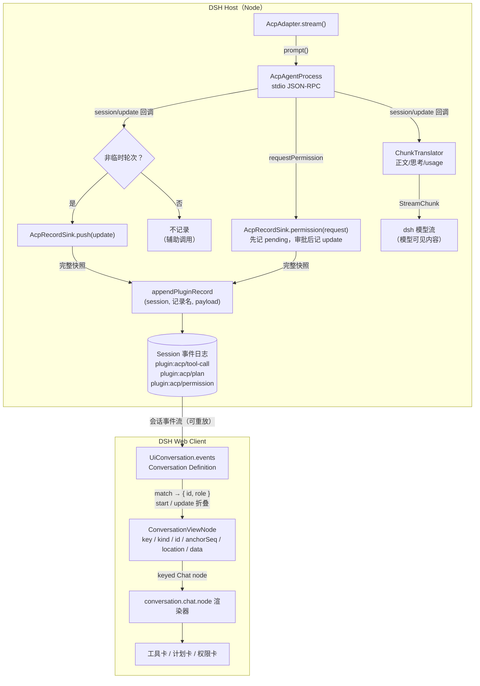

# 架构：ACP 执行记录 → Web 卡片

> 本文描述当前已实现的记录链路。未来的模块边界、配置与会话设计见 [长期架构设计](design/acp-plugin-architecture.md)，实施顺序见 [路线图](roadmap.md)。

本文记录本插件新增的「执行过程记录 + 卡片渲染」链路：Host 怎么把 ACP 更新写成会话记录，Web Client 怎么把它们折叠成卡片，以及为什么不用 dsh 的原生工具卡。

相关源码：

- [`src/host/service/acp-record-sink.ts`](../src/host/service/acp-record-sink.ts)
- [`src/shared/records.ts`](../src/shared/records.ts)
- [`src/host/apply.ts`](../src/host/apply.ts)
- [`src/host/service/acp-adapter.ts`](../src/host/service/acp-adapter.ts)
- [`src/client/conversation/records.ts`](../src/client/conversation/records.ts)
- [`src/client/components/record-nodes.tsx`](../src/client/components/record-nodes.tsx)

## 数据流



两条通路互不影响：**模型可见内容**来自 `ChunkTranslator`（正文、思考、usage），**展示卡片**来自记录层。记录层写失败只会禁用记录，不会影响这一轮对话。

## Host 侧

### 记录器在哪、什么时候启动

`AcpAdapter` 的每轮 `stream()` 先判断这一轮是不是「临时轮次」：

```ts
const ephemeral = dshSessionId === undefined || purpose !== undefined
const recording = ephemeral ? undefined : this.host.startRecording?.(dshSessionId)
```

- 有 dsh Session、且没有 `purpose`（标题生成、压缩等辅助调用带 `purpose`）才记录。
- `host.startRecording` 由 [`src/host/apply.ts`](../src/host/apply.ts) 注入：用 `ctx.get('sessions')` 取到 `Session`，再调用 `createAcpRecordSink(session, logger)`；拿不到 Session 就返回 `undefined`。
- 之后在 ACP `prompt()` 的 update 回调里，`recording?.push(update)` 与 `translator.push(update)` 并排执行。记录是同步追加的，所以卡片会随流式更新实时出现。

### 快照语义

每条记录 = **该身份在写入时刻的完整展示状态**，不是增量：

- 记录器在内存里为每个 `toolCallId` 维护一份 `ToolState`，`tool_call_update` 合并进这份状态后**整体**重发；计划（`plan`）同理，每次重发完整 `entries`。
- `phase` 标记这是该身份的第一条（`start`）还是后续更新（`update`）。跨轮用 `runId`（每轮一个 UUID）区分，避免不同轮次复用同一个 ACP 工具调用 id 时串卡。
- 因此客户端折叠规则很简单：**后来的记录直接替换状态**，不需要重放更早的记录、不需要增量合并，也不会因为分页只加载了后半段而算错。

写入前在 Host 侧做有界截断，日志体积可控：

| 内容 | 上限 |
| --- | --- |
| 单个文本内容块 | 8000 字符，超出追加 `… (N chars omitted)` |
| diff 的 old / new 单侧 | 20000 字符 |
| 原始 input / output（JSON.stringify 后） | 4000 字符 |

ACP 内容块到展示块的归一化：

| ACP `ToolCallContent` | 记录里的 `content[]` | 卡片表现 |
| --- | --- | --- |
| `content` + text 块 | `{ type: 'text', text }` | `<pre>` 文本 |
| `content` + image 块 | `{ type: 'image', mediaType, bytes }` | 图片占位（媒体类型 + 字节数） |
| `content` + resource_link | `{ type: 'link', name, uri }` | 链接占位 |
| `content` + resource(text) | `{ type: 'text', text }` | 文本 |
| `diff` | `{ type: 'diff', path, oldText, newText }` | 逐行 diff；行数过大时按整段回退 |
| `terminal` | `{ type: 'terminal', terminalId }` | 终端占位（不渲染终端流） |

工具调用还保留 `locations`（`path` + 可选 `line`），卡片的摘要行优先显示第一个位置，否则显示压平后的原始输入前 160 字符。

权限请求不走 `session/update` 流：它由 ACP 的 `requestPermission` 回调到达，记录器为此暴露 `permission(request)`——先写一条 `phase: 'start'`、`status: 'pending'` 的快照，返回一个「收尾」函数；审批结束后用最终状态（`allowed` / `rejected` / `cancelled`）再写一条 `phase: 'update'`。所以权限卡在审批框打开时出现，答复后状态原地更新。没有记录器（`startRecording` 返回 `undefined`）时整条路径跳过，审批照常进行。

### 记录写入 API 的语义

记录用 `@deepseek-ai/dsh-session` 的 `appendPluginRecord(session, type, data)` 追加，`type`/`data` 的对应关系通过 `PluginRecordMap` 的声明合并获得类型检查。dsh 对这个 API 的语义说明：

- 记录是 **plugin record**：类型在 `plugin:` 命名空间，事件带 `ignorable: true`。
- **log-only**：不产生消息，**不进入模型可见的 surface**。模型看到的对话历史不受影响。
- 不认识该记录的读取方会**保留并跳过**它，而不是拒绝恢复会话。
- resume / fork 会随日志一起携带记录；Session 格式迁移以**尽力而为**的方式保留。
- dsh 文档把这个 API 面向仓库内的 `packages/experimental/`；对外部插件**不是稳定的官方承诺**，因此升级 dsh 需要复核（见[兼容性](#兼容性)）。

写失败的处理：`appendPluginRecord` 抛错时记录器把自身标记为 disabled，之后不再尝试，并 `logger.warn` 一次。**这一轮对话继续**，只是没有卡片。记录名只是字符串，写入前 dsh 会校验记录名语法（`plugin:` + 小写分段）和无损 JSON 快照。

## 记录清单

常量定义在 [`src/shared/records.ts`](../src/shared/records.ts)。

| 记录名 | 常量 | payload | phase | 客户端折叠 key |
| --- | --- | --- | --- | --- |
| `plugin:acp/tool-call` | `ACP_TOOL_CALL_EVENT` | `AcpToolCallRecord` | `start` / `update` | `${runId}:${callId}` |
| `plugin:acp/plan` | `ACP_PLAN_EVENT` | `AcpPlanRecord` | `start` / `update` | `${runId}` |
| `plugin:acp/permission` | `ACP_PERMISSION_EVENT` | `AcpPermissionRecord` | `start` / `update` | `${runId}:${requestId}` |

### `AcpToolCallRecord`

| 字段 | 类型 | 说明 |
| --- | --- | --- |
| `phase` | `'start' \| 'update'` | 该工具调用的第几条快照 |
| `runId` | `string` | 每轮一个，隔离不同轮次 |
| `callId` | `string` | ACP `toolCallId` |
| `title` | `string` | Agent 给的工具标题 |
| `kind` | `string \| null` | ACP `ToolKind`：read/edit/delete/move/search/execute/think/fetch/switch_mode/other |
| `status` | `'pending' \| 'in_progress' \| 'completed' \| 'failed'` | ACP `ToolCallStatus` |
| `content` | `AcpToolContentView[]` | 上表的展示块，已截断 |
| `locations` | `{ path, line? }[]` | 涉及的文件位置 |
| `input` / `output` | `string \| null` | 截断后的原始 input/output |
| `startedAt` / `updatedAt` | `number` | 毫秒时间戳，卡片用它算耗时（只对终态显示） |

### `AcpPlanRecord`

| 字段 | 类型 | 说明 |
| --- | --- | --- |
| `phase` | `'start' \| 'update'` | 该轮计划的第几条快照 |
| `runId` | `string` | 每轮一个 |
| `entries` | `{ content, status, priority }[]` | `content` 截断到 8000；`status` 保留 ACP 词汇 `pending`/`in_progress`/`completed`（类型为向前兼容额外允许 `cancelled`，当前 ACP v1 不会发出）；`priority` 原样保留 |
| `updatedAt` | `number` | 毫秒时间戳 |

### `AcpPermissionRecord`

| 字段 | 类型 | 说明 |
| --- | --- | --- |
| `phase` | `'start' \| 'update'` | 该权限请求的第几条快照 |
| `runId` | `string` | 每轮一个 |
| `requestId` | `string` | 插件为这次请求生成的 id（ACP 权限请求本身没有可引用的请求 id） |
| `callId` | `string \| null` | Agent 关联的工具调用 id（有就带） |
| `title` / `kind` | `string` / `string \| null` | 请求标题与工具 kind |
| `options` | `{ id, label, kind }[]` | `kind` 为 `allow_once` / `allow_always` / `reject_once` / `reject_always` |
| `status` | `'pending' \| 'allowed' \| 'rejected' \| 'cancelled'` | 由 dsh 原生审批的结果决定；写入方在答复后再追加一条 `update` 记录 |
| `createdAt` / `updatedAt` | `number` | 毫秒时间戳 |

权限卡是**展示级**的：卡片只呈现请求、选项与最终状态，不提供答复按钮，答复仍由 dsh 原生审批框收集，避免两套入口竞争同一个请求。

## Client 侧

### Conversation Definition

dsh 的 `UiConversation.events` 为每个 target 注册事件 Definition（`ConversationNodeDefinition`）：

```ts
{
  kind: 'acp-tool-call',
  target: 'chat',
  match(event) { /* 只处理 plugin:acp/tool-call，返回 { id, role: data.phase } */ },
  start(context, match)  { /* 最早的一条 start 初始化 State */ },
  update(context, match) { /* 后续记录（含其它 start）更新 State */ },
  buildViewNode(context) { /* 物化成 keyed Chat node */ },
}
```

- `match` 的 `id` 决定哪些事件属于同一个节点；`role` 是 `start` / `update`。引擎用**当前窗口里最早的 start** 初始化 State，后续所有匹配（包括另一条 start）都用于更新——这正好匹配「完整快照」语义：`start`/`update` 都是整份状态，直接覆盖即可。
- 相同 `id` 的节点保持同一个 `key`，所以卡片在流式更新时是原地刷新，不会重复出现。
- `buildViewNode` 产出 `ConversationViewNode`：`key`、`kind`、`id`、`target: 'chat'`、`anchorSeq`（首条记录的事件序号）、`location`、`visibility: 'visible'`、`data`（渲染器要的字段）。`anchorSeq`/`location` 决定卡片插入到哪个轮次/步骤，以及和普通消息的相对顺序。
- 记录是持久事件，所以**历史重建**就是同一套 Definition 在恢复的日志上重放。只有更新记录、没有 start 记录的窗口不会凭空造出节点；窗口向前补页、拿到 start 记录后节点才建立——但一旦建立，折叠不依赖 start 之前的任何页。

### 渲染器

三个渲染器注册在 `conversation.chat.node` 这个 keyed 槽位上：

| node kind | 渲染器 | 说明 |
| --- | --- | --- |
| `acp-tool-call` | `AcpToolCallNode` | 紧凑头行 + 可展开体（文本/diff/占位/input/output） |
| `acp-plan` | `AcpPlanNode` | 清单卡，带完成数/总数 |
| `acp-permission` | `AcpPermissionNode` | 请求标题、工具 kind、选项行、状态胶囊（仅展示） |

约定：

- 文案走插件自己的 locale 命名空间 `dshAcpPro`（`ctx.locale.register`），中英各一份。
- 样式用 `.dap-*` 类名，只使用宿主的 `--dsw-*` 设计变量，随插件挂一个 `<style>`；web 壳不提供工具类 CSS。
- 卡片只渲染，不写日志、不调用 Host。

### `showToolCalls` 与卡片的关系

`ChunkTranslator` 仍然负责把 ACP 的工具调用/计划压平进推理块（旧行为），由 `showToolCalls` 控制。卡片是**独立通路**：即使 `showToolCalls: false`（本插件的默认值），记录照写、卡片照渲染。默认关掉压平行是为了避免同一件事在推理块和卡片里各显示一遍。

## 为什么不用 dsh 原生工具卡（`tool/call` + `tool-call` node）

dsh 原生工具卡是给 **dsh 自己发起的工具调用**用的：

- 它由 dsh 的 `tool/call` 会话事件（以及 assistant 消息里的 `tool-call` 块）驱动，`tool-call` 这个 Chat node kind 由宿主注册。
- 这些是 **surface 事件**：会进入派生消息/模型可见历史，并在后续请求里发给模型。

ACP 外部 Agent 的工具调用不是 dsh 发起的：

1. 它不是 dsh 的 `tool/call` 事件——只是 ACP `session/update` 里的 `tool_call` / `tool_call_update`；dsh 没有对应的工具定义、工具结果，也没有 dsh 侧的工具名/schema。
2. 伪造 `tool/call` 会把它写进模型可见历史，需要编造工具名、参数、结果，污染后续请求；ACP 的 update 是分字段的补丁（还会重复/乱序到达），和 dsh 原生工具调用的 start/delta/end 生命周期不一致，本来就要先在 Host 侧折叠成快照。
3. `tool-call` 这个 node kind 已被宿主占用，插件注册同名 key 会被 registry 拒绝；独立 Definition + 独立 kind 才是可组合的做法。

所以本插件选择：**记录用 log-only 的 plugin record（不影响模型），展示用自定义 Chat node**。代价是卡片只能展示，不能参与 dsh 的工具结果/统计；收益是它天然可重放、可跳过、可随会话恢复。

## 兼容性

- **DSH 版本**：`appendPluginRecord` 与 `PluginRecordMap` 属于 dsh 的插件记录机制，dsh 文档把它面向 `packages/experimental/` 的包，外部插件可用但不是稳定承诺。升级 dsh 时要一起复核：函数是否仍在、记录名语法、`ignorable` 语义、Conversation Definition 的注册 API、`conversation.chat.node` 槽位与 `PropsRuntime` 形状。
- **记录名**：`plugin:acp/*` 用简写 owner（dsh 内部约定 owner 取包名后缀）。记录名只是字符串，不影响读取；但升级时应确认记录名语法没有收紧。
- **记录形状**：读取端（Definition/渲染器）目前直接消费当前声明类型。记录是 `ignorable` 的，旧版本 dsh 读到会原样保留；如果未来改字段，需要自己按 `phase`/字段做版本兼容，不能让旧记录把渲染器打崩。
- **截图与实测**：`docs/e2e-cards.png` 是工具卡的实测截图（Codex ACP 路由）；计划卡与权限卡的结构以本文件与源码为准。
