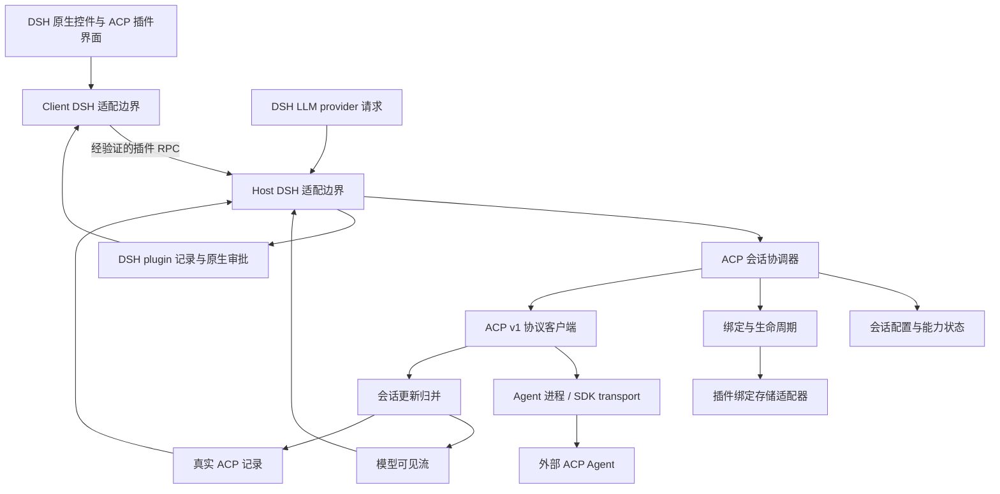
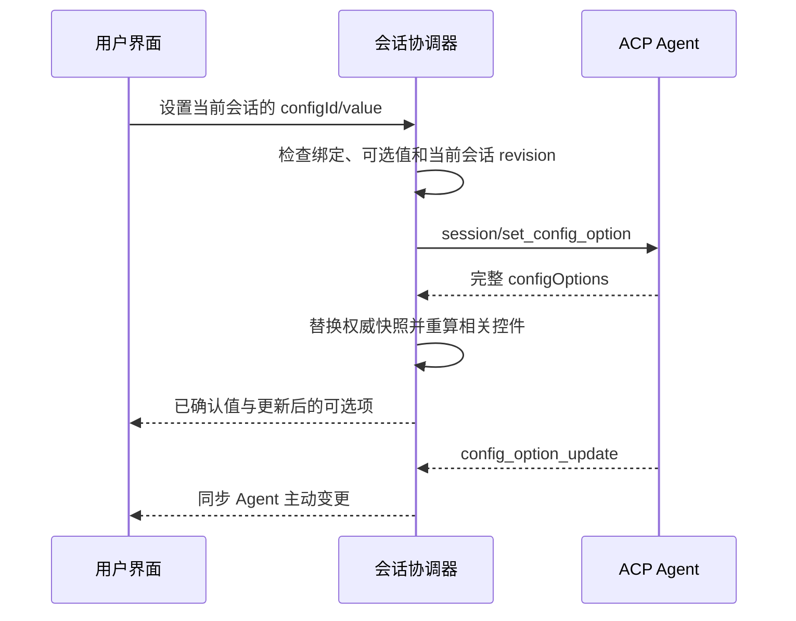

# DSH ACP 插件长期架构设计

> 日期：2026-10-26。状态：已作为实施依据；当前落地进度与验收状态见路线图。
> 本文描述目标设计，不表示所有能力已经实现。实施顺序见 [路线图](../roadmap.md)，规划时的事实基线见 [仓库审计](current-architecture-audit-2026-10.md)，协议与开源项目证据见 [ACP 调研](acp-reference-research-2026-10.md)。

## 1. 建议与边界

采用**单仓库、单插件包、渐进分层**：保留现有 ACP 执行与真实记录链路，把 DSH 接口集中到适配边界，再围绕会话补齐配置、恢复和交互。首个用户价值是让模型、思考强度和模式的“可选项、当前值、实际执行值”一致。

“无需修改上游”定义为：在明确支持、未经本插件打补丁的 DSH 版本上完成约定能力；不依赖向 DSH 源码写补丁，不依赖本地 checkout 的偶然实现。它不意味着支持所有历史和未来 DSH 版本，也不意味着 DSH 所有接口已经稳定。

当前暂按“标准 DSH 可运行，额外能力随扩展接口可用性降级”设计；用户原文中的 `mit` 尚无独立项目含义的证据。本仓库确实基于 MIT 许可代码，`LICENSE`、`NOTICE` 和既有归属保持完整。这里的代码解耦不涉及更改许可。

可观察的最终体验分为三层，分别验收：

| 层次 | 用户结果 | 必要条件 |
| --- | --- | --- |
| 基础对话 | 选择 Agent/模型，发送、流式输出、停止、审批；错误可理解 | 已验证的 DSH provider/approval 接口和 Agent 基础 ACP 能力 |
| ACP 会话能力 | 当前会话的模型、思考强度、模式、命令和恢复状态准确 | Agent 返回对应配置/能力，插件控制链路完整 |
| 原生界面融合 | 输入区控件、工具/计划行、文件跳转符合 DSH 交互习惯 | 经验证的 DSH 插槽、记录、导航和 RPC 扩展面 |

视觉一致可以由插件组件实现；事件所有权仍属于 ACP。不能通过伪造 DSH `tool/call` / `tool/result` 达到表面一致。

## 2. 现状与需要先解决的问题

| 发现 | 证据 | 对设计的影响 |
| --- | --- | --- |
| provider 注册、增量 prompt、取消、图片输入、权限映射和三种记录卡已存在 | `src/host/apply.ts`、`src/host/service/acp-adapter.ts`；完整链路见仓库审计 | 保留现有行为，以纵向切片迁移，避免重写整个插件 |
| 模型选择已优先调用 `set_config_option` 并应用返回选项 | `src/host/service/acp-agent.ts:228` 起的 `selectModel` | 旧路线中“先迁移到 set_config_option”已过时 |
| 思考强度已解析、暴露给 DSH，并在生成前设置 | `acp-agent.ts:93-108`、`acp-adapter.ts:251`、`acp-adapter.ts:386` | 先验证 UI → GenerateOptions → ACP 的实际断点，不把它当完全未实现 |
| `resolveModel(provider, model)` 使用进程级 `advertisedEfforts`，真实配置随会话/模型变化 | `acp-adapter.ts:240-258`；`acp-agent.ts:153-188, 228-241, 324`；审计含 mock 证据 | 拆开模型目录缓存和当前会话配置；增加按模型验证的回归用例 |
| 本地 DSH 依赖经 symlink 提供，peer 范围为 `*`；记录 API 被指南标为实验性 | `package.json`；`docs/dsh-plugin-dev/07-safety-compatibility.md:39` | 本地编译成功不能证明标准发行版兼容；先建立版本/接口证据 |
| 还有具体的宿主内部耦合：fiber/loader 结构、internal/plugin 事件、遍历 loader 的 MCP 发现 | `src/host/apply.ts:27-60,82-87,205-206`；`src/host/service/mcp-servers.ts` | 优先隔离这些内部接缝，不把所有导出 API 都笼统称为私有 |
| Models 页面提示通过 MutationObserver 改写 DOM；bundle 的 cordis.patch.yml 是正常插件声明 | `src/client/register/models-hint.ts:7-20`；`cordis.patch.yml:1-3` | 去掉依赖官方页面文案/结构的提示补丁，移到插件自身设置/帮助；不要误删合法 bundle 声明 |
| 会话绑定与已消费消息存在进程内；现有 UI 没有完整会话配置控制面 | 见审计中的 bindings、client 注册、RPC 和持久化章节 | 配置、会话身份、生命周期要成为显式模块 |

这里确认的是代码和契约问题。用户当前“不能调整思考强度”的现场根因仍需具体 DSH/Agent/模型的运行证据，不能由静态分析直接归因。

## 3. 目标结构

这是目标依赖关系，不是对尚未验证的 DSH RPC、存储或插槽的可用承诺。P0 先验证这些接口；缺少必要扩展面时缩小对应阶段交付，不引入另一个本地服务或修改 DSH 来掩盖限制。

### 3.1 模块职责

| 模块 | 拥有什么 | 不拥有什么 | 现有代码起点 |
| --- | --- | --- | --- |
| DSH Host 适配边界 | provider 元数据、GenerateOptions 翻译、原生审批、plugin record、配置与宿主服务接入 | ACP wire 格式、Agent 业务状态 | `host/apply.ts`、`service/acp-adapter.ts`、`service/permission.ts` |
| 会话协调器 | 当前绑定、每会话操作顺序、prompt/cancel/config/lifecycle 协调 | React、Cordis 注册细节、文件展示 | `service/acp-adapter.ts` |
| 会话配置与能力 | 原始选项、当前值、待确认写入、连接/会话能力和派生 UI 信息 | 硬编码所有 Agent 的功能表 | `service/acp-agent.ts` 的 models/efforts 逻辑 |
| ACP 客户端 | initialize、协议方法、通知、传输错误、SDK 版本差异 | DSH 记录、DSH 模型目录、UI | `service/acp-agent.ts` |
| 进程管理 | spawn、环境、stdio、退出、generation 和清理 | 跨会话配置当前值 | `service/acp-agent.ts` 的进程部分 |
| 绑定存储 | 经过确认的会话身份与恢复所需最小状态 | API key、完整 ACP transcript 的第二份永久副本 | 当前内存 bindings；具体存储 API 待 P0 验证 |
| 更新与展示 | ACP 更新归并、记录快照、客户端行模型和渲染 | 发明 Agent 未上报的结果或状态 | `acp-record-sink.ts`、`chunk-translator.ts`、`client/conversation/records.ts` |

建议目录随阶段逐步形成：`src/host/dsh/`、`src/host/acp/`、`src/host/runtime/`、`src/client/dsh/`、`src/client/acp/`。保持 `src/shared/` 只存跨端 DTO、记录 schema 和常量。先抽离真正存在的依赖，再移动文件；不为目录整齐做一次性大迁移。

每个外部边界只定义当前有调用者的窄接口。复用 ACP SDK 与现有工具，不新增 DI 框架、事件总线平台、数据库或依赖注入容器；出现第二个实际宿主之前不发布独立通用 core 包。

### 3.2 DSH 兼容边界

建立一份版本化兼容清单：DSH 发行版本、包版本、接口来源、是否实验性、验证用例和结果。把必要依赖与可选依赖分开：

1. provider/生成/审批属于基础执行面；缺失时明确说明不支持该版本，不能报告插件已正常启用。
2. 记录写入、Conversation Definition、渲染插槽、输入区插槽、导航、插件 RPC 分别核验；同名符号存在不等于语义兼容。
3. 可选导出不能在模块顶层静态导入后再靠函数存在性判断降级，否则模块加载已先失败。按 DSH bundle loader/exports 实际行为选择可选加载或明确提高最低版本，必须有加载测试。移除 Models 页面 DOM 提示改写；内部 loader/fiber 访问先隔离，再逐项换成经验证的公开接口，尚无替代者保留在明确支持的版本边界内。
4. 记录接口不可用时，基础对话和原生审批仍可工作；不产生伪工具事件。不承诺此时仍有相同卡片、回放和行内操作。
5. 收窄 `peerDependencies` 的前提是标准发行版测试结果；现在不编造最低支持版本或向后兼容范围。

对上游的扩展提案是可选协作项。只有已进入受支持发行版并通过验证的扩展，才能变成插件依赖。

## 4. 会话配置：首个完整纵向切片

### 4.1 三种状态必须分开

| 状态 | 来源与用途 |
| --- | --- |
| Agent/profile 默认偏好 | 用户设置；用于建立新会话时提出选择意图，不代表 Agent 已接受 |
| 模型目录/发现结果 | 临时发现会话或 Agent 声明；用于列出模型，不能冒充每个模型的最终配置 |
| 当前会话权威配置 | `session/new`、支持的恢复响应、`set_config_option` 全量响应和 `config_option_update`；决定实际 UI 当前值 |

保留 Agent 提供的 `configId`、类型、值 ID、分组、名称和顺序。`category` 仅决定摆放方式；缺失或未知 category 仍走通用控件。不能只识别 `thought_level` 后丢弃其他合法选项。完整配置契约见 [ACP v1 配置规范](https://agentclientprotocol.com/protocol/v1/session-config-options)。

初期支持仓库锁定 SDK 能正确读写的 `select`。只有 UI、DTO 和 SDK 全链路支持后才宣告 boolean capability；未知类型保持 Agent 默认并隐藏不可操作控件。具体字段以固定 schema/SDK 的测试样例为准。

### 4.2 设置流程

每个会话串行处理配置写入，并与下一次 prompt 的提交顺序协调。切换模型后，重新读取返回的全部选项，再决定旧思考强度是否仍合法；不把默认模型的 levels 复制给其他模型。不支持的旧偏好被清除或标为未应用，不自动挑一个名称相近的值。

界面区分“正在应用”和“已生效”；请求失败不更新为成功。响应和主动通知进入同一有序归并路径；本地 revision 只管理客户端顺序和过期视图，不能冒充 Agent 提供的全局事务版本。

P1 先允许空闲时设置；生成中明确标为下一回合应用，停止操作始终可用。ACP 允许生成中设置，但它如何影响正在进行的生成取决于 Agent；后续仅在明确验证语义后开放即时修改。

### 4.3 和 DSH 原生模型/思考强度控件的关系

优先复用 DSH 已有 `resolveModel().reasoning` 与 `GenerateOptions.reasoningEffort` 通路。注意 `resolveModel(provider, model)` 没有 sessionId：它只能返回该模型在明确发现上下文下的能力快照，不能返回某个活动会话的个性化当前值。模型专属元数据需要在隔离的发现会话中确认，不得为了查询目录而切换用户的活动会话；发现不可用时宁可保留未确认状态，也不复用另一模型的 levels。

当前值由具体会话持有，元数据中的 defaultEffort 不代表它。若 DSH 提供可验证的会话选择读写/通知契约，原生控件和 ACP 面板可以同步到这份确认状态；若没有，同一个配置只保留一个可编辑入口：模型/effort 优先使用原生通路，插件面板展示确认结果或隐藏重复控件，其他配置通过独立选项操作。不能靠猜测每个 GenerateOptions 值是“新用户意图”还是“旧默认值”来解决两个编辑入口冲突。

P0/P1 需采样：Agent 返回选项 → 指定模型的元数据 → DSH 控件 → GenerateOptions → ACP 请求 → 响应与后续 prompt。已有 mock 的不同模型支持不同 levels，是首个回归场景；无 `thought_level` 的 Agent 不显示假的强度开关。

原生 UI 只能表达部分配置时，通用选项放在插件的当前会话面板；输入区插槽、双向 RPC 和原生控件同步契约必须先验证。Settings 中的全局默认值不能被包装成当前会话已生效值。不存在必要扩展面时，保留已验证的原生通路，并如实列出余下能力受限。

## 5. 协议和能力边界

### 5.1 版本模型

固定三个不同的版本概念：wire `protocolVersion`、schema 发布版本、SDK 包版本。ACP v1 作为默认基线；v2 仍在 draft 时只做隔离实验，不能用一个“v2 开关”让 v1 代码接受不同的更新和生命周期语义。

优先使用当前协议的配置方法。官方 SDK 的 unstable 方法、Agent 自定义扩展、稳定规范三者分别标注；`session/set_model` 不应被笼统称为“Claude 私有接口”，也不能当稳定必有方法。旧路径仅在相应版本/能力有证据时使用。详见调研中的版本表和固定源码。

未来 v2 用独立 decoder/协议适配实现，再归一到已经验证的内部事件；共享 UI 不直接判断原始 v1/v2 payload。只有稳定发布、目标 Agent 支持和跨版本样例通过后才调整默认协议。

### 5.2 能力是分层事实

| 作用域 | 事实 | 失效条件 |
| --- | --- | --- |
| Agent 安装/启动配置 | 可执行入口、版本、参数、认证上下文引用 | 安装或配置变化 |
| 连接 | 协商协议、initialize capabilities、auth methods | 进程重启、重连、身份变化 |
| 会话 | configOptions、modes、commands、workspace、可恢复身份 | 新建/恢复、模型变化、Agent 通知、workspace 变化 |
| DSH 宿主 | 支持的 provider/record/RPC/slot 契约 | DSH 版本变化 |

能力状态至少区分未探测、明确不支持、可用和调用失败；失败不是协议不支持。缓存不只以 `agentInfo.version` 为 key，也不把运行状态写成一张永久的全局特性表。Registry 和第三方探测矩阵用于发现与诊断，最终以当前连接和会话为准。

命令来自 `available_commands_update`，按 ACP 约定提交 prompt，不维护通用 `/compact` 假定。v1 的 fs/terminal 由目标 Agent 和 DSH 实际能力决定是否接入，不能仅因 v2 移除就永久排除；未实现的客户端能力绝不宣告。MCP 透传不自动等价于 ACP filesystem/terminal 方法。

## 6. 生命周期与持久化

### 6.1 会话身份

绑定以 DSH session + provider/profile 为入口，至少记录 ACP sessionId、workspace/cwd、协商协议、启动配置指纹和存储 schema 版本。模型/配置保存“最后确认状态”，只用于恢复后核对。认证只存引用；不复制密钥、敏感环境变量或进程对象。

绑定和正在运行的进程分离。Agent process generation 变化使旧连接句柄失效，但不直接证明远端会话不能恢复。模型切换是否需新会话遵循 Agent 当前能力；不要仅因选择器变化就销毁上下文。

### 6.2 恢复决策

1. 加载绑定，核对 profile、cwd、协议和 Agent 身份；启动并协商。
2. 按已验证的能力选择 v1 load 或相应可选生命周期方法；不根据“协议版本是 v1”推断 resume/list/fork 全部存在。
3. 成功后以响应/回放重新建立状态；区分恢复回放和实时更新，保证工具卡、计划、用量不会重复累计。
4. 无法恢复时进入明确的“新会话”路径；历史上下文重放不等于恢复 Agent 内部状态。先检查持久的待确认回合，不能把它通过 `fullPrompt(conversation)` 悄悄再提交，也不重发历史待执行工具。
5. 取消、进程退出和关闭分别结算待决请求及审批；dispose 幂等。DSH 删除会话不默认等于删除 Agent 远端会话，外部删除策略应单独明确。

`consumed message ids` 与绑定持久化保持同一确认边界；不在 prompt 未完成确认时把消息写成已消费。同时，发送 prompt **之前**持久化一个最小待确认标记：本地 turn id、对应 DSH message ids、绑定身份及 `unknown` 状态；得到确定完成结果后，与 consumed 游标在同一次存储更新中结算。该本地 turn id 不是 Agent 提供的幂等键。

崩溃可能发生在 Agent 已执行工具而本地尚未收到响应之间。恢复时仅依据可可靠关联的 Agent 状态/回放证据对账；无法确认则保留“结果未知”，禁止自动重提这一回合。即使转入新会话，也要抑制未知回合经历史上下文自动重发。此异常路径由用户明确选择后续继续/新会话操作；不能按文本相似或本地超时推断之前未执行。

取舍是：没有服务端幂等键或可验证回合身份时，不能承诺 exactly-once。方案优先避免恢复机制自动重复提交，代价是实际未送达的请求也可能停在未知状态，等待明确续跑；不是无条件保证所有工具只执行一次。P2 必须验证“工具副作用已发生 → 本地确认前崩溃”的场景。

插件日志不是第二套永久对话存储；这里只增加必要的提交状态，不引入通用任务队列。第一版仅在稳定的插件数据目录内实现最小存储；具体目录/原子写入方式依据 P0 的宿主契约决定。

## 7. 记录、权限与原生体验

保留两条输出通路：模型可见文字/推理流，以及 log-only 的 `plugin:acp/*` 记录。归并器复用现有正确的快照规则，不新增另一套全量事件仓库。v1 tool content 替换与 partial update 的语义、v1 单计划与未来多 planId 的语义分别测试。

新增记录采用可演进 schema：旧记录缺少版本时按旧形状读取，新增字段向后兼容；发生结构变化时显式迁移。工具唯一键包含实际会话和 toolCallId；回合归属由真实提交/更新建立，不通过时间猜测。截断在显示中可见，失败或等待审批的行保持可见。

原生审批服务继续是决策权威。插件 permission 卡先只负责准确显示；将来行内答复必须走经验证的宿主通道和同一个待决请求，做到至多结算一次，并处理取消/关闭。历史重放的 permission 卡不能重新触发审批。

借鉴 MonoCode 的行结构、活动分组和可展开详情，但按工具、思考、计划、权限、用量拆组件，不复制巨型 transcript 组件。需要的原生体验包括键盘操作、文件位置跳转、错误定位和中文/英文文案，而不仅是颜色接近。

只有实际报告的 token/cost 才显示；区分上下文占用、会话累计、原生回合值和差分估算。累计成本差分仅在同一身份、单回合边界清晰且无重置/回放等干扰时标为估算；缺少证据时不显示精确回合花费。性能目标先采样固定机器与样例，再定预算，撤销无测量依据的“1k 工具调用仍 60fps”承诺。

## 8. 借鉴边界与选择记录

| 选择 | 理由 | 代价与后续 |
| --- | --- | --- |
| 渐进模块化，保留单包 | 现有协议/记录链路可复用，便于小步验证 | 需要临时适配旧路径；逐阶段删除本次替代的死代码 |
| DSH 依赖集中隔离 | 限制升级影响范围，不把实验性接口传播到业务状态 | 不能消除上游 API 本身不稳定；仍需版本契约测试 |
| 配置优先于视觉重做 | 先解决可观察的使用限制和状态准确性 | 第一阶段保留多数现有卡片样式 |
| Agent 原始配置为权威 | 支持模型相关 reasoning 和未知配置，避免硬编码 Agent 表 | 需要处理异步确认、关联选项和会话作用域 |
| ACP v1 基线 + 独立 v2 实验 | 当前稳定面与 draft 语义分开 | 将来需要第二组协议样例，不能承诺零迁移成本 |
| 参考 Multica 的 runtime 边界、MonoCode 的配置/展示交互 | 直接改善本插件生命周期与体验 | 不引入 Multica 团队任务平台、远端 daemon 产品或新的 IDE 外壳 |

备选方案：

- 继续在 `acp-agent` / `acp-adapter` 中叠加功能，短期改动少，但会让连接级缓存、会话状态、宿主耦合更难控制，不作为长期方向。
- 一次性提取独立 Agent 平台/多包 SDK，能够提供更强分离，但当前只有一个宿主，迁移和维护成本缺少用户价值支撑；等出现第二个实际使用方再评估。
- fork DSH 以获得所有原生交互，最容易做表面一致，却与摆脱上游修改依赖的目标冲突；只有用户明确改变产品边界时才重议。

## 9. 验证与未决事项

每个阶段都以 [路线图](../roadmap.md) 的退出条件结束。测试针对协议消息、用户可观察状态和故障恢复，不按文件搬迁逐个新增镜像测试。现有 TypeScript/Vitest 门禁仍必须执行；Host/Client 运行变更还需要构建 `dist/`、在受支持 DSH 上重启验证。

当前未决事项不阻碍本轮设计交付，但会限制对应实施承诺：

| 未决项 | 最小验证 | 影响 |
| --- | --- | --- |
| 用户现场思考强度不可选的直接原因 | 具体 Agent/profile/model 与 DSH 控件、请求、响应的一条 trace | 决定 P1 第一项修复，不能预先承诺缓存修复能解决全部现场问题 |
| 标准 DSH 的最小兼容版本与扩展契约 | 干净发行版加载、必要/可选接口探测和基本操作 | 决定版本范围与完整 UI 能力下限 |
| 会话面板的双向 RPC、持久化和 lifecycle hook | 一个只读当前会话状态的最小集成验证，再验证一项写入 | 决定模式/通用配置面板和恢复功能可行路径 |
| 目标 Agent 的恢复、客户端工具与扩展能力 | 固定 Agent/SDK 版本的握手、配置和恢复测试 | 决定后续能力优先级，避免按生态宣传列打勾 |

本设计不承诺完成时间；实施容量、目标 Agent 版本和 P0 证据确认后再估算。验收通过一个阶段后再推进下一阶段，不把所有未来功能都纳入首轮重构。
