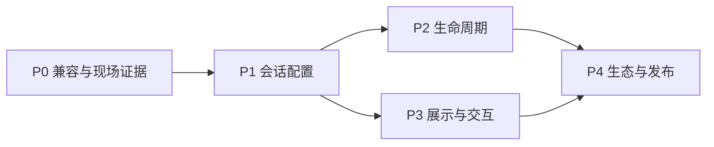

# dsh-acp-pro 长期路线图

> 更新：2026-10-26。状态：实施中，当前推进 P0/P1；阶段是否完成以代码与验收证据为准。
> 建议顺序：**兼容边界 → 配置与思考强度 → 会话可靠性 → 原生交互 → 生态与协议演进**。
> 本文替代 2026-10-25 的版本排期；旧稿中的有用方向保留，尚无依据的周数和性能承诺撤回。

## 1. 目标和交付边界

让 ACP Agent 在 DSH 内可用、可控、可恢复，并以符合 DSH 习惯的界面展示真实执行。核心目标是在明确支持的标准 DSH 发行版上运行，不要求用户修改 DSH 源码；实验性接口和可选增强能力单独管理。

采用 [长期架构设计](design/acp-plugin-architecture.md) 的单包渐进方案。先复用现有代码解决实际能力缺口，再提取必要边界；不做全仓重写、不复制一个 Multica/MonoCode 产品、不为尚未出现的第二个宿主发布通用框架。

规划阶段产物：本路线图、架构设计、[实施前仓库审计](design/current-architecture-audit-2026-10.md)、[ACP / Multica / MonoCode 调研](design/acp-reference-research-2026-10.md)。用户现已要求继续实施；具体进度见文末，许可与归属保持完整。

## 2. 基线校准

| 项目 | 当前结论 | 后续动作 |
| --- | --- | --- |
| 模型与思考强度 | 已有 configOptions 解析、模型优先 set_config_option、reasoning 元数据和生成前 effort 设置 | 复现现场问题，检查模型作用域、状态更新和 UI 链路；不重复实现已存在的协议调用 |
| provider / prompt / 取消 / 审批 / MCP / 记录卡 | 已有实现与测试，具体覆盖见审计 | 作为回归基线保留 |
| 认证 | 已支持 profile authMethod、ACP authenticate 和认证错误映射 | P4 关注登录引导/凭据交互的缺口，不重做基础认证调用 |
| DSH 依赖 | 本地 symlink 环境可分析；peer 范围为 *；记录与渲染 API 有实验性边界 | 不以本地运行推断发行版兼容，P0 建立支持矩阵 |
| 会话恢复与完整控制面 | 当前绑定主要在内存；当前会话模式/通用配置等交互未完整接通 | P1/P2 建立明确状态与生命周期 |
| 协议与生态资料 | 旧稿混用了当前实现、稳定规范、SDK unstable 和未来方案 | 以固定版本调研为依据；不再把 set_model 一概视作某个 Agent 私有方法 |

具体代码证据集中在审计中。用户的思考强度问题尚未做真实 UI/Agent 复现，规划不宣称已经定位或修复现场故障。

## 3. 能力优先级

| 能力 | 目标 | 阶段 | 验收依据 |
| --- | --- | --- | --- |
| 模型、思考强度 | 当前模型的选项准确，设置确实用于后续执行 | P1 | 指定模型元数据 + 设置请求/回包 + UI 和后续 prompt |
| 模式、通用配置、Agent 命令 | 按当前会话声明呈现，未知 category 仍可使用通用控件 | P1 | 配置变更、Agent 主动更新、无能力隐藏、错误不冒充成功 |
| 取消、断连、恢复、进程清理 | 无串会话、无悬挂审批、恢复不自动重提结果未知的回合 | P2 | 故障/重启/恢复协议样例和真实 Agent 冒烟 |
| 工具、计划、diff、位置、思考、权限 | 真实事件 + 一致交互 + 可访问的细节查看 | P3 | 老记录回放、键盘交互、错误/审批不被折叠 |
| 图片/资源、用量、通知、压缩 | 按实际协议能力逐项完善 | P3 | 内容不丢失，用量来源标明，回放不重复统计 |
| 登录、fs/terminal、注册表、子会话 | 目标 Agent 有需求且宿主具备条件时接入 | P4 | 每项独立能力证据；不把 MCP 等同 ACP 客户端工具 |
| ACP v2 | 稳定与需求满足后独立适配 | P4 研究，后续实施 | v1 不回归，v2 专属样例和目标 Agent 验证 |

不同 Agent 不必通过它未声明支持的同一组功能。首批真实验证建议选 Codex ACP 的 reasoning 路径，以及另一个具有不同配置/能力形状的 Agent；具体版本和认证环境在 P0 固定，不能在规划时写成已验证。

## 4. 分阶段实施

### P0：冻结事实，验证 DSH 边界

**结果**：知道支持哪一个标准 DSH 版本、思考强度断在哪一层，以及哪些增强能力能只靠插件实现。

工作范围：

1. 记录当前 DSH/SDK/Agent/插件版本与现有检查结果；将“源码已实现”“mock 验证”“真实 Agent 验证”“标准 DSH 验证”分列。
2. 追踪具体场景中的 configOptions、resolveModel(model)、UI 控件、GenerateOptions.reasoningEffort、set_config_option 与返回选项；只记录必要配置与状态，不采集聊天正文或密钥。
3. 核验 provider、approval、appendPluginRecord、Conversation Definition、chat/input 插槽、RPC、插件数据目录和 session lifecycle 的来源与语义。
4. 以一个最小纵向切片提取 DSH 依赖，优先处理 loader/fiber 内部接缝和 Models 页面 DOM 提示改写；把提示迁入插件设置/帮助，保留合法的 cordis.patch.yml bundle 声明。暂不大规模移动文件，不假设可选静态导出能靠运行时判断降级。

主要起点：`src/host/apply.ts`、`src/host/service/acp-adapter.ts`、`src/host/service/acp-agent.ts`、`src/client/index.ts`、`package.json` 和插件开发指南。

**退出条件**：

- 在至少一个未经本插件修改的 DSH 发行版上，从构建 bundle 到注册 provider、发送/取消、审批完成基本冒烟；记录具体版本和失败项。
- 有一条完整 reasoning trace；若现场无法复现，保留限制，并用现有 mock 中不同模型的 levels 场景建立可失败的回归用例。
- 记录/渲染等可选接口缺失的加载与降级策略有实际测试；必要接口缺失时给出明确不支持结果。
- 为 P1 当前会话控件确认可用通道；若无可用 RPC/插槽，先限定为现有 DSH 原生模型/effort 通路，不承诺通用面板已可实现。

### P1：配置状态正确，模型与思考强度真正可用

**结果**：用户看到的当前值与 Agent 确认值一致，模型变化会更新其可选 reasoning levels。

工作范围：

1. 把模型目录发现、连接能力与当前会话配置分开；修复经测试确认的模型作用域/刷新问题。
2. 建立会话配置归并与串行写入，应用设置响应的全量 configOptions，并接收 Agent 主动更新。
3. 复用 DSH 原生模型与 effort 控件；依据 P0 结果补当前会话模式、通用配置面板和动态命令入口。resolveModel 不带 sessionId，模型能力发现不得借用活动会话；若没有原生选择同步契约，同一配置只保留一个可编辑入口。
4. 保留标准配置优先和必要的版本限定兼容路径；不硬编码 low/medium/high/max 为所有 Agent 的通用能力。

主要起点：`acp-agent.ts` 的 `sessionModels/sessionEfforts/selectModel/selectEffort`，`acp-adapter.ts` 的 `resolveModel/run`，客户端设置/输入区接入，跨端配置 DTO。

**退出条件**：

- 不同模型返回不同 levels 的测试先失败再修复通过；切换模型后不存在旧选项残留或非法旧偏好自动发送。
- 设置失败、Agent 主动修改、缺失 category、未知 category、分组 select 与缺失 thought_level 均有针对实际契约的覆盖。
- 一条真实 Agent 链路证明用户选择、set_config_option 回包和后续回合一致；另一个 Agent 验证能力缺失/不同配置的正常降级。
- 同时打开两个 DSH 会话时，各自配置互不串扰；生成中设置明确标为下一回合应用，停止仍有效。

### P2：会话可恢复，生命周期可解释

**结果**：重启和故障后不会悄悄混入其他 workspace、重复工具结果或把新会话说成已恢复。

工作范围：

1. 提取会话协调器与进程管理边界；保持已验证的增量 prompt、取消和关闭行为。
2. 增加版本化绑定存储，使用 P0 确认的插件数据目录；保存最小身份、已确认状态和发送前的 pending-turn 标记，确认后与 consumed 游标原子结算，不复制凭据或整套 transcript。
3. 按 Agent 声明及已验证版本实现 load/resume 等恢复路径；list、fork、delete、close 分别决策，不作为捆绑必选能力。
4. 建立恢复回放与实时更新的区分，并对 pending turn 对账；无可靠证据时保留结果未知，禁止自动重提及通过新会话 fullPrompt 间接重放，由用户决定后续操作。恢复不可用时明确进入新会话，历史上下文重放不等价于恢复内部状态；无 Agent 幂等键时不承诺 exactly-once。

主要起点：`acp-adapter.ts` 的 `bindings/run/dispose`、`acp-agent.ts` 的连接/会话/close、`prompt.ts`、记录归并和未来存储适配器。

**退出条件**：

- 两会话、两 cwd、同一 provider 的隔离测试通过；Agent generation 变化后不会复用旧连接句柄。
- 桌面重启后支持恢复的 Agent 能继续原会话；不支持恢复的 Agent 进入可识别的新会话路径。
- 取消、Agent 退出和关闭均结算待决请求/审批，dispose 可重复调用；恢复回放不重复计费或重复工具卡。
- 验证“Agent 工具副作用已发生、本地确认前崩溃”：有恢复证据时正确对账，无证据时保持未知且不自动重提；不支持恢复的新会话同样抑制未知回合历史重放。明确可能暂停实际未送达请求的取舍。

### P3：补齐原生交互与内容

**结果**：ACP 的工具、计划、思考、审批和富内容在 DSH 内可以自然浏览和操作，且历史会话可回放。

工作范围：

1. 拆分行模型/渲染器，优先工具状态、计划、diff、位置跳转与思考折叠；沿用 DSH tokens 和插件 i18n。
2. 继续使用原生审批；只有 P0 验证答复通道后再做行内操作，与同一待决请求绑定，不生成第二套授权结果。
3. 按 Agent 能力补资源/图片/音频、通知、压缩、标题和用量；仅为已经实现的客户端契约声明 capability。
4. 兼容旧 plugin records；以固定数据样例采样长会话性能后再设预算。

主要起点：`src/shared/records.ts`、`acp-record-sink.ts`、`chunk-translator.ts`、`src/client/conversation/records.ts`、`components/record-nodes.tsx`、样式与 locale。

**退出条件**：

- 相同 ACP 事件在实时显示和历史恢复中产生相同事实；未知新增字段、旧版记录不导致页面崩溃。
- 工具失败/待审批保持可见，展开区可键盘操作，文件位置可跳转；真实 DSH 截图和交互结果留档。
- 审批至多结算一次，取消/关闭后不能操作旧请求；历史权限记录不会重新请求授权。
- 用量区分上下文、会话累计、原生回合值与估算；缺失数据不显示精确成本。长会话记录量、更新耗时和渲染样例可复测。

### P4：扩展生态与稳定发布

**结果**：新 Agent 更容易接入，协议升级有明确边界，发布不依赖某台机器的 symlink 环境。

按需求分批处理，不全部塞进一个版本：

1. Agent 配置/认证诊断与 registry 发现、安装；使用 registry 及探测矩阵辅助选择，但运行时能力仍以握手和会话为准。
2. 对目标 Agent 必须的 v1 fs/terminal 或 elicitation 实现对应宿主适配；如果没有实际需求，保持未宣告。
3. 子会话按已验证协议扩展显示，保留父子身份和审批归属；不自动扩展到团队任务调度产品。
4. 独立研究 v2；待稳定性和 Agent 支持满足后写专门迁移 ADR，避免把 v1/v2 payload 到处混在 UI 中。
5. 发行版兼容矩阵、干净环境构建安装、升级/回退、README/排错与变更日志；npm/市场发布作为后续明确交付项，不在本轮执行。

**退出条件**：每项增强各自通过“能力声明 → 请求 → 结果 → 缺失降级”验证；公开支持矩阵只列实测组合；升级能读取既有记录/绑定，回退策略由变更类型明确。

## 5. 依赖与可拆分顺序



P2 和 P3 只有在共享 DTO/记录契约已定且文件所有权不重叠时才并行；完整仓库门禁串行运行。每个实施 PR 提供一个用户可见结果或一个可测依赖边界，包含相关测试、文档和回退办法。

第一批实施建议依次拆为：

| 切片 | 交付 | 主要范围 |
| --- | --- | --- |
| A | 支持矩阵与 reasoning 现场证据；必要的 DSH 边界最小验证 | 文档、诊断、现有集成入口 |
| B | 按模型返回准确 reasoning 元数据并更新会话配置 | acp-agent、acp-adapter、mock/tests |
| C | 原生控件与会话面板共享确认状态，补模式/通用配置 | config DTO、Host RPC、Client 控件；以 A 的接口结论为前提 |
| D | 持久绑定与第一种真实恢复路径 | session coordinator、store、lifecycle tests |
| E | 工具/计划/权限展示纵向切片与旧记录兼容 | record sink、shared records、client renderer |

以上是实施切片及依赖关系；当前交付状态见第 9 节，实机退出条件仍需逐项取得运行证据。

## 6. 验证规则和完成定义

仓库规定的每个变更批次门禁：

```bash
node node_modules/typescript/bin/tsc --noEmit
node node_modules/vitest/vitest.mjs run
```

Host/Client 运行变更另外按 `skills/engineering/dsh-plugin/SKILL.md` 构建 `dist/`，重新加载/重启 DSH 后验证 provider 与 UI。依赖受限环境使用已有本地二进制，不以自动下载替代环境问题诊断。

测试层次：协议/状态用 mock fixture 验证；DSH 接口用契约/加载验证；真实 Agent 冒烟验证配置和恢复语义；UI 验证需要的操作与回放。只扩充本阶段真实风险相关用例，不建立所有能力排列组合的穷举矩阵。

发布前必须保有：未经修改的 DSH 支持组合、已验证 Agent/SDK 版本、记录/绑定兼容结果、已知缺失能力与可复现证据。未运行的真实 Agent、标准 DSH、构建安装或 UI 项必须明确列出，不能用单元测试通过代替。

## 7. 对旧路线的保留与修订

| 旧方向 | 本轮处理 |
| --- | --- |
| 原生工具/计划行、真实 plugin records | 保留；先配置与兼容，再做视觉重构 |
| 模型切换先迁到 set_config_option | 当前代码已实现；改为补模型/会话作用域、更新和 UI 闭环 |
| 固定 1–3 周排期、所有 Agent 都能切模式/跑 compact | 撤回无依据排期；按阶段退出条件和具体 Agent 能力验收 |
| agentInfo.version 级能力缓存 | 改为安装、连接、会话、DSH 宿主分层；配置不能当全局常量 |
| 自动全量历史重放就是恢复 | 区分新会话与真实恢复，并处理副作用、重复更新和消费游标 |
| v2 移除 fs/terminal，所以 v1 永不支持 | 改为由目标 Agent 实际需求决定，不虚报客户端能力 |
| registry 没有能力资料 | 更正：已有协议探测矩阵；但它不等于当前会话配置的权威来源 |
| 把成本累计差分当精确每回合成本 | 仅在满足归因条件时标为估算；缺失数据不猜测 |
| 把 set_model 视为单一 Agent 私有接口 | 区分官方 SDK unstable/遗留面与稳定配置协议 |

历史生态采样仍保留在 [2026-10-25 survey](acp-ecosystem-survey.md)，作为当时的观察，不作为当前接口承诺。

## 8. 规划阶段验收记录（实施前基线）

- 已形成架构、分阶段计划、仓库审计和一手实现调研，并通过主架构定向审查；审查补入了 pending-turn/unknown 恢复边界与对应验收。
- 已独立核对 reasoning 的模型作用域证据、DSH 实验性记录边界，以及 Multica/MonoCode 的固定源码。现有运行代码检查基线：TypeScript 退出码 0；Vitest 12 个文件、93 个测试通过；这些结果不证明真实 DSH/Agent 已通过验收。
- 未实施 runtime 重构，未安装/升级 Agent，未运行真实 DSH/Agent UI 场景，未提交或发布。
- 用户原文 `mit` 的具体含义尚未补充，暂按标准 DSH 无补丁运行理解；许可归属保持完整。

## 9. 实施进度

- P0：已核验本机 DSH 安装观测、原生 reasoning 的源码调用链和扩展接口边界，详见[兼容性证据](dsh-plugin-dev/09-compatibility.md)。源码契约不等于已安装应用实测；完整 P0 仍未验收。
- P1 代码已覆盖模型专属 reasoning、会话 select 配置、模式和动态命令。原生模型/思考强度保持唯一编辑入口；输入区面板显示确认状态，Host 队列协调设置与 prompt。真实 Typert Registry/Gateway 已验证控制调用，应用内面板与选择器待验收。
- P2 代码已覆盖持久绑定、能力驱动 load、消费游标、恢复用量基线及未知结果阻断。未确认回合不自动重提；显式新会话建立历史重放边界。确定性故障回归与真实 Agent 的恢复验收分别记录。
- P3 本批交付工具位置与 diff 跳转、状态可见性、键盘操作、长内容提示及旧记录兼容；继续使用原生审批和真实 `plugin:acp/*` 记录。真实截图、长会话性能采样和能力条件性增强仍按阶段退出条件推进，未宣称全部完成。
- 已移除 Models 页面 DOM 提示改写，补充默认不发送 prompt 的 smoke 诊断。最终门禁、审查和范围见[实施记录](../.omc/plans/dsh-acp-evolution.md)，后续 DSH 可直接执行[实机验收交接](dsh-verification-handoff.md)。本会话未安装、重启 DSH 或执行真实 Agent 验收；P4 的条件性生态与发布项目保留为后续工作。
